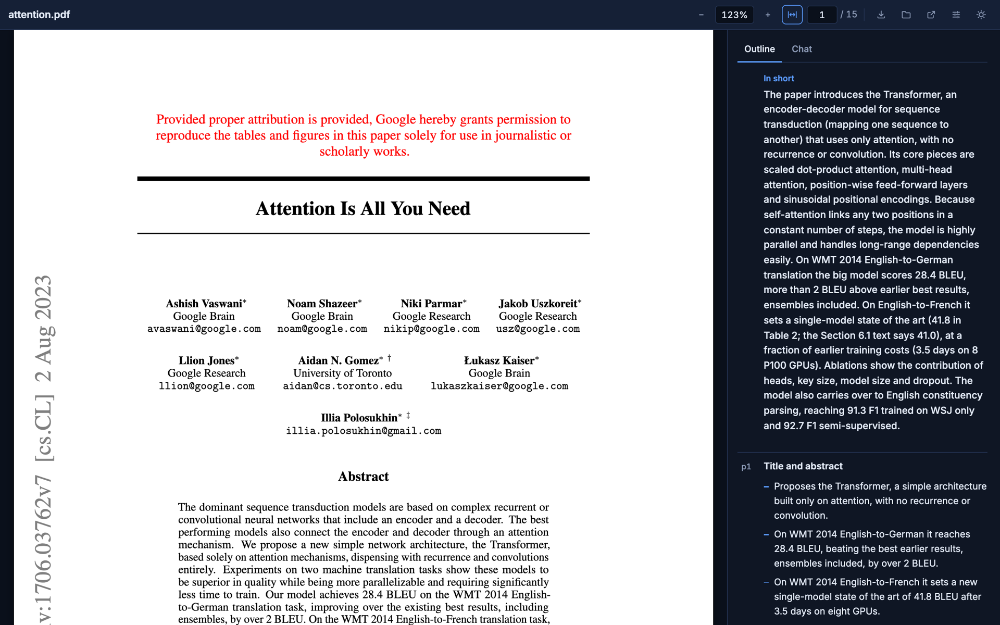
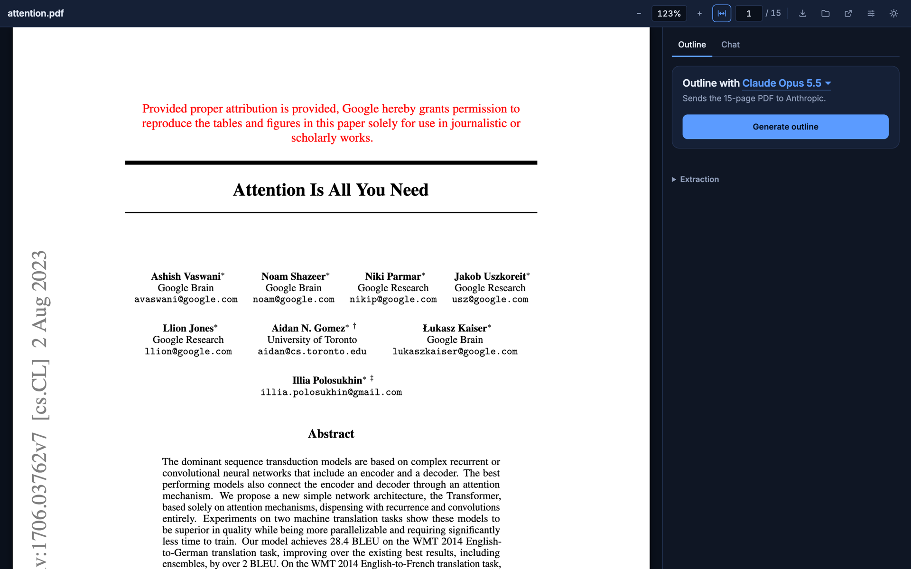
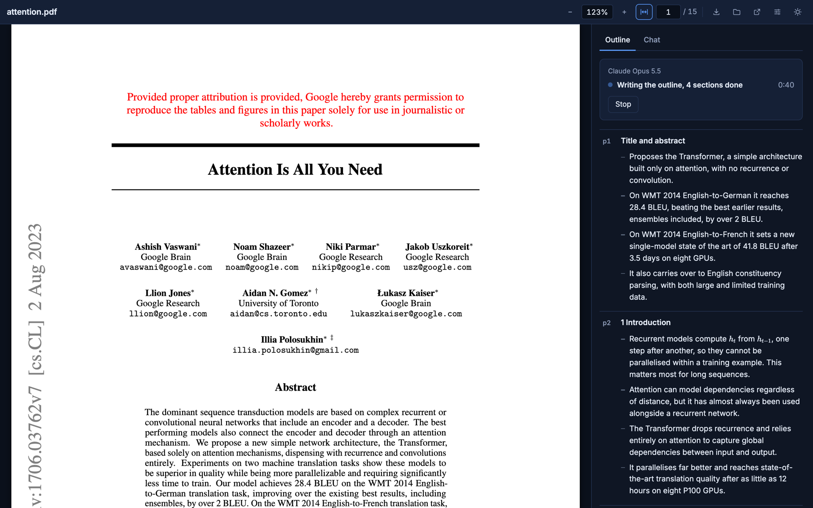
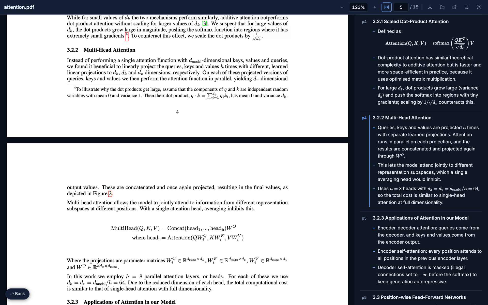
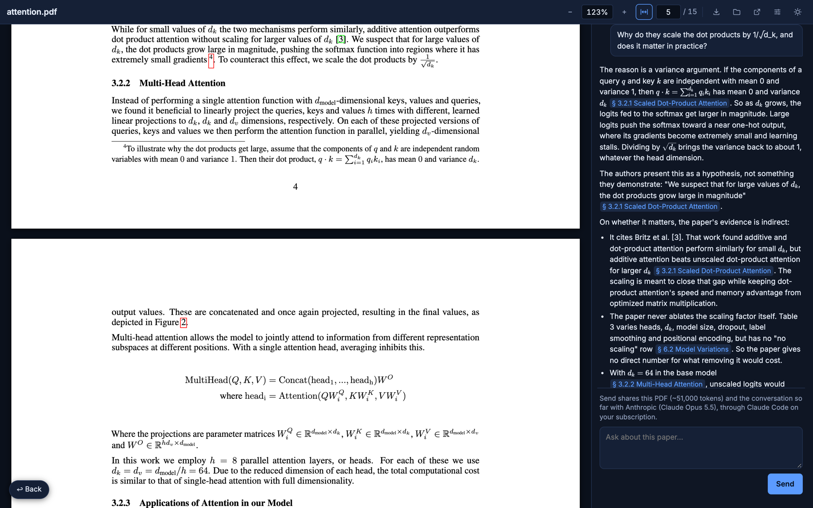

# Scholar Reader

A Firefox / [Zen](https://zen-browser.app) extension that replaces the browser's PDF viewer with a two-pane reader for research papers. The paper is on the left. On the right is an outline of it, section by section, written by the model you pick. Clicking a bullet takes you to the sentence it summarises. A **Chat** tab answers questions about the paper and links each answer back to the section it came from.



I built it for my own reading, so it is tested on Zen on macOS. Firefox should work too. It is not on addons.mozilla.org. The signed builds are unlisted and you install them from a file (see [Install](#install)).

## Features

- **Opens every PDF you click.** Any `application/pdf` response opens in the reader, including the extensionless links arXiv and publishers use. The extension keeps the browser's own download instead of fetching the file a second time. This matters for one-time links such as ScienceDirect's, which refuse a second request. A per-site opt-out and a "open in the browser's own viewer" button are there when you need the built-in viewer.
- **Outlines by section.** One request covers the whole paper. A TL;DR comes first, then each section's key points in reading order, with results quoted as numbers. Bullets fill in while the model is still writing. A progress line shows the stage and elapsed time, and **Stop** cancels the run.
- **Bullets that jump to the right sentence.** The model copies a short quote for each bullet. The viewer finds that quote among the paper's own lines and scrolls there, highlighting just that column. If the quote can't be found, it matches the bullet's words instead, and failing that it goes to the section heading. **Back** (or Alt+←) returns you to where you were reading.
- **Chat about the paper.** Ask questions in the Chat tab. Answers cite sections as `§ links`, which can also point at a quoted sentence, and clicking one jumps there. Each paper keeps its own conversation.
- **Typeset maths.** Equations in outlines and chat answers are rendered with KaTeX. KaTeX is bundled, so nothing is fetched.
- **The model reads the PDF itself.** Claude and Gemini receive the original PDF (up to 100 pages / 30 MB), not a flattened text layer, so superscripts, equations and tables arrive intact. Longer papers are sent as text extracted in reading order, which also handles two-column layouts. The reference list is never sent.
- **Nothing leaves without your say-so.** Before a paper goes anywhere, the outline pane tells you what will be sent and to whom, for example "Sends the 15-page PDF to Anthropic." Your approval is remembered per paper and per model. A cached outline reopens instantly and makes no network request.
- **Reading comforts.** Dark theme by default, with a light theme. The reader remembers your page in each paper. You can resize the panes, type a page number or zoom level, save the PDF, and open local files.

## Screenshots

| | |
|---|---|
|  |  |
| **Before anything is sent**, the pane says what goes where. Choose the model from the dropdown. | **While the outline is written**, you see its progress and can stop it. Sections appear as they finish. |
|  |  |
| **Click a bullet** and the paper scrolls to the sentence it restates. **Back** returns you. | **Chat** answers cite the paper's sections, and each citation is a link. |

*The paper shown is Vaswani et al., [Attention Is All You Need](https://arxiv.org/abs/1706.03762) (arXiv 1706.03762). Google grants permission to reproduce it for scholarly use with attribution. The outline and the answer are real Claude Opus 5.5 output.*

## Models

| Model | Where the paper goes | How you pay | Used for |
|---|---|---|---|
| **Claude Opus 5.5** (default), Sonnet 5.5, Haiku 5.5 | Anthropic, through Claude Code on this computer | Your Claude subscription, no API key | Outline + chat |
| **Gemini 4** Argon, Carbon, Hydrogen, Neon | Google, with your own API key | Your Gemini API key | Outline + chat |
| **Gemma 4 E4B** via Ollama | Nowhere, it runs on this computer | Free | Outline only |

The model never changes behind your back. If Opus reaches a usage limit, the pane says so, tells you when the limit resets, and offers the other models for you to pick from.

## Install

### Signed build

Download the `.xpi` from the [Releases](https://github.com/notKivon/firefox-pdf-reader/releases) page. In Zen or Firefox, open `about:addons`, click ⚙, choose **Install Add-on From File…**, and pick the file. Unlisted builds don't update themselves, so install each new release the same way.

### From source

Requires Node 22 / npm 10.

```bash
git clone https://github.com/notKivon/firefox-pdf-reader.git
```

```bash
cd firefox-pdf-reader && npm ci && npm run build
```

Next, open `about:debugging#/runtime/this-firefox`, click **Load Temporary Add-on…**, and select `dist/manifest.json`. A temporary add-on is removed whenever the browser restarts. After each rebuild, press **Reload** on the add-on's card.

## Setup

Open settings with the sliders button in the reader's toolbar, or from `about:addons` → Scholar Reader → Preferences.

### Claude (the default): the local bridge

Claude models go through a small local server, `tools/claude-bridge.mjs`. It runs [Claude Code](https://claude.com/claude-code) in headless mode under your own claude.ai login. Usage counts against your subscription, as interactive Claude Code does. The bridge removes any `ANTHROPIC_API_KEY` from its environment and refuses to start unless `claude auth status` shows a claude.ai login.

1. Install Claude Code and log in with your subscription.
2. Start the bridge at every login (a macOS LaunchAgent):

   ```bash
   npm run bridge:login
   ```

   If you'd rather run it once in a terminal, use `npm run bridge` instead.
3. Paste the token it prints into settings → **Claude bridge token**. The token is stored in `~/.config/scholar-reader/bridge-token`.

The bridge listens only on `127.0.0.1:8765` and answers only requests that come from the extension and carry the token. Its log is at `~/Library/Logs/scholar-reader-bridge.log`. After pulling changes to `tools/bridge/`, restart it:

```bash
launchctl kickstart -k gui/$(id -u)/local.scholar-reader.bridge
```

Rerun `npm run bridge:login` after moving the checkout or changing Node version. To remove the LaunchAgent, run `npm run bridge:login -- --off`.

### Gemini

Create a key at [Google AI Studio](https://aistudio.google.com) and paste it into settings. The key is stored only in the extension's `storage.local`.

### Local model (Ollama)

Install [Ollama](https://ollama.com), run `ollama pull gemma4:e4b`, and allow the extension's origin. For the macOS app:

```bash
launchctl setenv OLLAMA_ORIGINS "moz-extension://*"
```

Restart Ollama afterwards. This setting does not survive a reboot. If you run `ollama serve` in a terminal, export the variable in that shell instead.

## Using it

1. Click any PDF link. The paper opens in the reader.
2. In the outline pane, choose a model and press **Generate outline**. The pane says what will be sent before you press it.
3. Click a bullet to jump to the sentence it summarises. Press **Back** or Alt+← to return.
4. Switch to **Chat** to ask questions. The line above the box says what **Send** shares and with whom, and pressing Send approves it for that paper. **New chat** starts over.
5. For a PDF on disk, click the folder button, or the toolbar button when no paper is open.

## Development

| Command | |
|---|---|
| `npm run build` | Bundle into `dist/` (esbuild, no minification) |
| `npm run watch` | Rebuild on change |
| `npm test` | Unit and integration tests in Node, against stubs: no network, key or browser needed |
| `npm run check:secrets` | Fail if `dist/` or any tracked file contains something shaped like an API key |
| `npm run package` | Build, secrets check, `web-ext lint`, then write the XPI and a source archive to `web-ext-artifacts/`. Refuses an uncommitted tree. |
| `npm run bridge` / `bridge:login` | Run the Claude bridge now / at every login |
| `npm run probe` | Send one fixture to a real provider and report outline quality. Uses real quota. |

The code is plain JavaScript in ES modules with no framework. It uses `pdfjs-dist`'s `PDFViewer`, KaTeX, and Inter, all bundled. **[CLAUDE.md](CLAUDE.md)** lists the rules the code has to keep: when text may be sent, how documents are identified and cached, and where a jump's position may come from. **[SPEC.md](SPEC.md)** describes how each part works. **[PROGRESS.md](PROGRESS.md)** has the release history, the open issues, and the design decisions with their reasons.

### Signing a release (AMO, unlisted)

1. Bump `version` in both `manifest.json` and `package.json`, then commit.
2. Run `npm run package` to write `web-ext-artifacts/scholar-reader-<version>.xpi` and `…-source.zip`.
3. At <https://addons.mozilla.org/developers/addon/submit/distribution>, choose **On your own** and upload the XPI. When asked for source code, upload the source zip (`dist/` is bundled by esbuild) along with the reviewer notes below.
4. Once it is signed, go to Developer Hub → the add-on → **Manage Status & Versions** → the version. Clicking the signed `.xpi` link installs it straight into the browser you're in. To get the file itself, use **Save Link As…**, or copy it out of the profile: `~/Library/Application Support/zen/Profiles/<profile>/extensions/scholar-reader@kevin.local.xpi`.

Reviewer notes:

```
Build: Node 22, npm 10. In the source archive: `npm ci && npm run build`.
The extension is the resulting dist/ directory, which matches the uploaded XPI
file for file. esbuild bundles without minifying. Third-party runtime code is
pdfjs-dist, KaTeX and the Inter font (see package-lock.json); pdf.js's worker,
cmaps, fonts and wasm are copied unmodified from node_modules. The web-ext lint
warnings all come from that pdf.js code.
Data: the open PDF, or its extracted text, is sent to the model the user picks
(Anthropic via a local Claude Code bridge, Google's Gemini API with the user's
key, or a local Ollama server), and only after the user confirms each document
in the page. No data goes to the developer.
```

## Secrets

No API key is ever committed. Keys are entered on the settings page and kept in `browser.storage.local`. `.gitignore` covers `dist/`, `.env`, `*.key` and `*.xpi`. `npm run check:secrets` scans the built bundle for anything shaped like a key, and every tracked file for full-length keys. Run it before every packaging step. The repository is public, so deleting a key that was pushed does not help: revoke it and create a new one.
